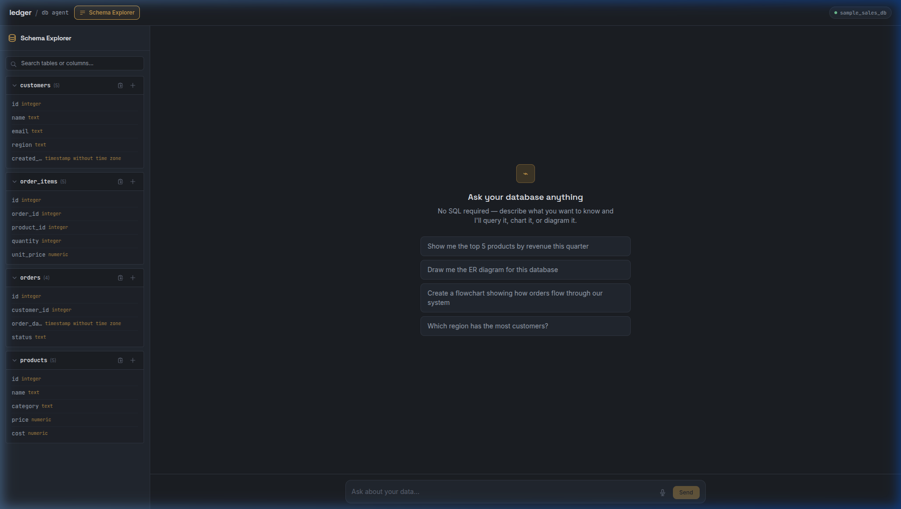
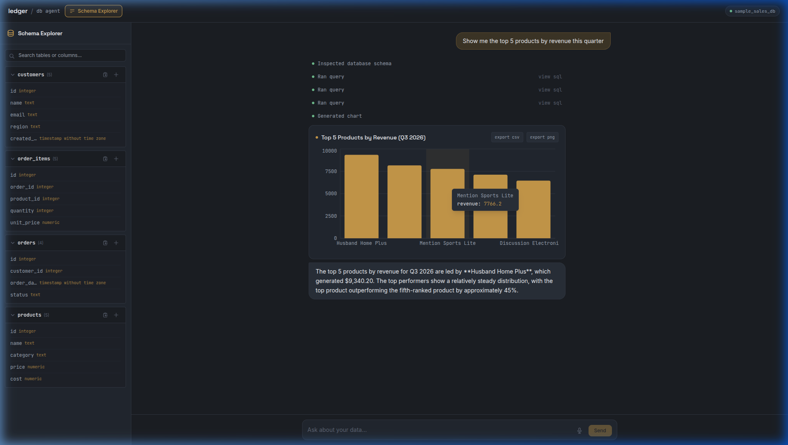
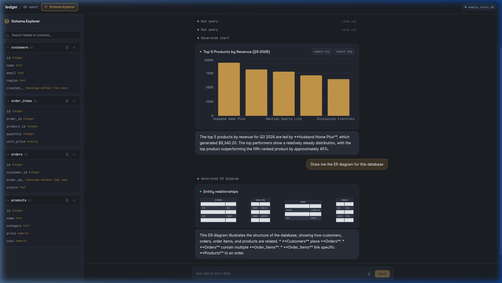
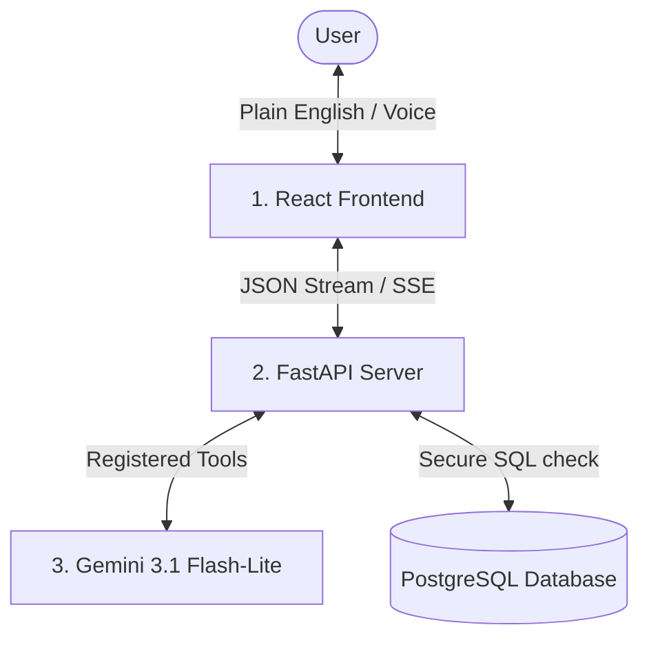

# Ledger — Talk to Your Database, Visualized

Imagine having a **senior database analyst** on your team who is available 24/7, understands plain English (and voice commands!), constructs beautiful charts instantly, and handles all security validations automatically. **That is Ledger.**

Ledger is a conversational database agent designed to bridge the gap between technical data structures and business insights. Whether you want to see sales trends, check product inventories, or map out how tables relate to each other, you can just ask Ledger as if you were talking to a colleague.

---

## 🎨 Walkthrough & Key Features

### 1. Interactive Database Explorer (Your Schema Blueprint)
For non-technical users, databases can feel like a black box. The **Schema Explorer** exposes a visual map of all tables, columns, and data types (such as `integer`, `text`, or `timestamp`) directly in a sidebar. 

* **How it helps**: Instead of guessing what columns exist (e.g., is it `customer_id` or `id_customer`?), you can inspect the schema in real time. You can also copy table or column names, or insert them directly into your chat bar with one click.



---

### 2. Conversational Chart Generation (English to Insights)
When you ask Ledger a question like *"Show me the top 5 products by revenue this quarter"*, the agent behaves like a human analyst:
1. It looks at the database tables to figure out where order and product details are.
2. It writes a secure read-only SQL query and runs it.
3. It transforms the numbers into an interactive visual graph.
4. It provides a brief text summary explaining what the numbers actually mean.

* **Bonus Business Tools**: Any generated chart can be exported instantly to a **CSV spreadsheet** or downloaded as a **PNG image** for presentation slides.



---

### 3. Entity-Relationship Diagrams (Mapping the Connections)
If you want to understand how different business datasets connect (e.g., how orders link to products or customers), you can request: *"Draw me the ER diagram for this database"*. Ledger will construct a clean relationship map showing tables and key columns.



---

## 🎙️ Speech-to-Text Integration
Don't feel like typing? Click the microphone icon in the chat bar to dictate your query. Ledger uses native browser-based voice synthesis, showing a pulsing recording state while capturing your voice, and automatically inputs the translated text into the query box.

---

## 🧠 How It Works (Simplifying the Tech)

Ledger is built using a **three-layered architecture**:



1. **The Interface (React Frontend)**: The screen you see. It handles speech recognition, rendering graphics (Recharts), drawing diagrams (Mermaid.js), and styling the layout with a sleek neon dark-theme.
2. **The Guard (FastAPI Backend)**: The broker between the user and the database. It enforces absolute security:
   - **AST Validation**: Every SQL query is parsed using `sqlglot` before it hits the database. If a query tries to delete, modify, or inject malicious code, it is rejected immediately.
   - **Restricted Database Role**: The database connection uses `agent_readonly` permissions, making it physically impossible for the agent to change data.
   - **Output Clamp**: Queries are automatically restricted to returning a maximum of 100 rows to keep things lightning fast.
3. **The Brain (Gemini 3.1)**: The AI model that processes what you say, decides which tool to call (query database, draw diagram, make chart), and formats the final summary.

---

## 🚀 Setting Up & Running the Project

Ensure you have your **Gemini API Key** from [Google AI Studio](https://aistudio.google.com/apikey) and a **PostgreSQL Connection String**.

### Option A: Spin Up via Docker (Recommended)
This runs the entire system in isolated containers with a single command:

1. Configure your environment variables in `backend/.env` (copy `backend/.env.example`).
2. Run:
   ```bash
   docker-compose up --build
   ```
3. Open [http://localhost:5173](http://localhost:5173) in your browser.

---

### Option B: Local Setup (Manual)

#### 1. Setup the Database & Seed Data
1. Run `backend/schema.sql` on your database instance to provision tables (`customers`, `products`, `orders`, `order_items`) and configure the `agent_readonly` user.
2. Setup the backend virtual environment:
   ```bash
   cd backend
   python -m venv .venv
   source .venv/bin/activate  # On Windows: .venv\Scripts\activate
   pip install -r requirements.txt
   ```
3. Create a `backend/.env` file containing:
   ```env
   GEMINI_API_KEY=your_gemini_api_key
   GEMINI_MODEL=gemini-3.1-flash-lite
   DATABASE_URL=your_postgres_owner_connection_string
   FRONTEND_ORIGIN=http://localhost:5173
   ```
4. Seed the mock store data:
   ```bash
   python -m app.seed
   ```
5. **Crucial Security Step**: Edit `backend/.env` and replace `DATABASE_URL` with your restricted `agent_readonly` connection URL to protect against unauthorized modifications.

#### 2. Start Backend API
```bash
uvicorn app.main:app --reload --port 8000
```
Verify the API is running at [http://localhost:8000/api/health](http://localhost:8000/api/health).

#### 3. Run Frontend UI
1. Navigate to the frontend directory:
   ```bash
   cd ../frontend
   npm install
   ```
2. Start the Vite server:
   ```bash
   npm run dev
   ```
3. Open [http://localhost:5173](http://localhost:5173) and start talking to your database!

---

## 🧪 Running Tests
Ledger features automatic tests checking the query security parser, chart creation tool schemas, and data explanations.
```bash
cd backend
PYTHONPATH=. .venv/bin/pytest tests/
```
